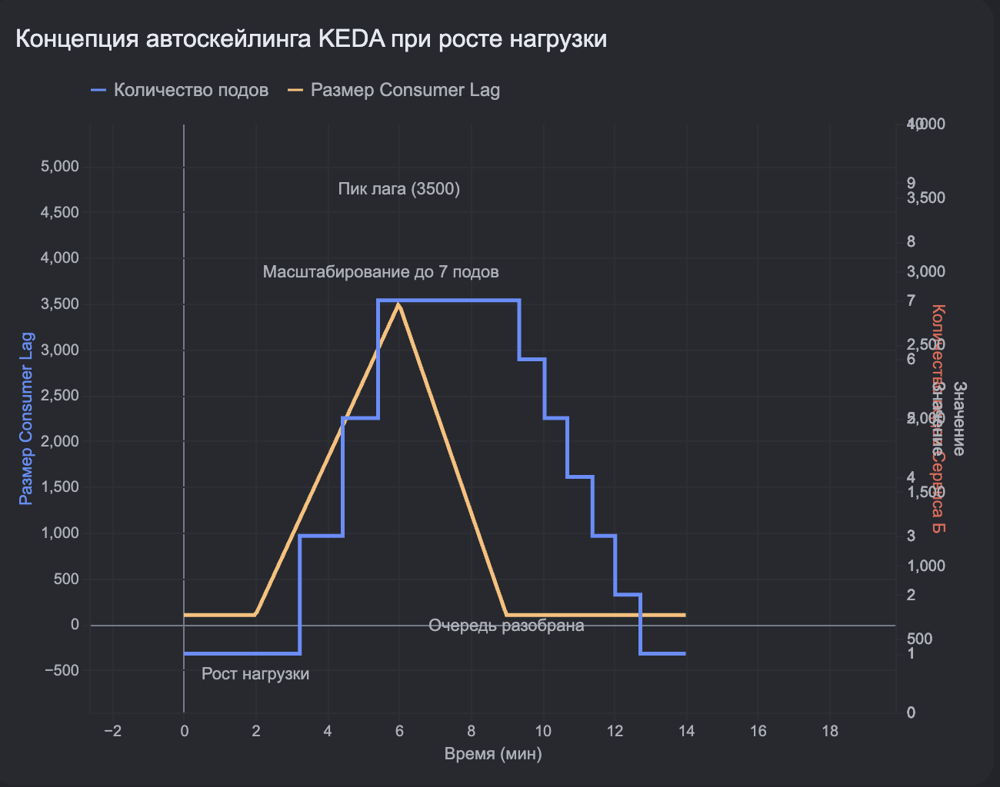

# Circuit Breaker

Circuit Breaker (Предохранитель) — это паттерн проектирования, который
предотвращает «эффект домино» в микросервисной архитектуре. Если один сервис
начинает тормозить или падать, предохранитель обрывает связь с ним, чтобы не
«уложить» всю систему.

Как это работает (3 состояния)

1. Closed (Закрыт): Всё хорошо. Запросы проходят через предохранитель к сервису.
   Он считает количество успешных и неудачных ответов.
2. Open (Открыт): Если процент ошибок превысил порог (например, 50% запросов
   упали), предохранитель «размыкается». Все последующие запросы к этому сервису
   даже не отправляются. Вместо ожидания тайм-аута они мгновенно получают ошибку
   или «запасной ответ» (Fallback). Это дает упавшему сервису время «прийти в
   себя».
3. Half-Open (Полуоткрыт): Через некоторое время предохранитель пропускает
   пробную партию запросов. Если они прошли успешно — он закрывается (всё
   починилось). Если нет — снова открывается.

Зачем это вам (на примере Spring Boot и 1000 RPS)
Представьте: сервис «Оплаты» стал отвечать за 10 секунд вместо 0.5с. При
нагрузке 1000 RPS все потоки вашего сервера (Tomcat) быстро забьются ожиданиями
ответов от «Оплаты». В итоге всё приложение перестанет отвечать вообще на любые
запросы.
Circuit Breaker просто отсечет запросы к «Оплате», и ваш сервис заказов
продолжит работать (пусть и без возможности оплатить).
Resilience4j — это стандарт для Spring Boot. Resilience4j — это современная
библиотека, которая легко настраивается через аннотации.
Что она умеет кроме предохранителя:

* TimeLimiter: жестко обрубает запрос, если он длится дольше лимита.
* Retry: если запрос упал, библиотека сама повторит его (например, 3 раза с
  паузой).
* RateLimiter: ограничивает количество запросов к сервису, чтобы не «заддосить»
  его самого.

Как ответить на интервью:

      «Я использовал Resilience4j для реализации паттерна Circuit Breaker. 
      Это позволило избежать каскадных сбоев: если один из 6+ микросервисов 
      начинал тормозить, предохранитель размыкал цепь, и мы отдавали 
      пользователю Fallback (запасные данные из кэша), сохраняя общую 
      работоспособность системы и свободные потоки в Tomcat».

Технически Circuit Breaker — это «умная обертка» вокруг сетевого вызова. В 95%
случаев в экосистеме Java это библиотека внутри вашего кода, а не отдельный
сервер.
Вот как это устроено на практике:

1. Где он находится в коде?
   В Spring Boot приложении он располагается на Service-слое (уровень
   бизнес-логики), там, где вы вызываете другой микросервис (например, через
   RestTemplate, WebClient или OpenFeign).
   Техническая реализация (Resilience4j):
   Это Proxy-объект (прослойка), который перехватывает вызов метода. Вы просто
   вешаете аннотацию на метод, который лезет в сеть:

```java

@CircuitBreaker(name = "fnsService", fallbackMethod = "fnsFallback")
public CheckResponse checkInFns(CheckData data) {
    // Реальный сетевой вызов к Налоговой
    return restTemplate.postForObject("https://fns.api", data, CheckResponse.class);
}

// Запасной метод, если ФНС тормозит или "лежит"
public CheckResponse fnsFallback(CheckData data, Exception e) {
    log.error("ФНС недоступна, сохраняем чек для позже обработки", e);
    return new CheckResponse("PENDING_VERIFICATION"); // Возвращаем статус "В очереди"
}
```

2. Как он работает внутри (Механика)?
   Библиотека (например, Resilience4j) хранит в памяти приложения кольцевой
   буфер (Ring Bit Buffer):

* Она записывает результаты последних $N$ вызовов (например, 100 штук).
* Если из этих 100 вызовов 50 завершились ошибкой или таймаутом, библиотека
  переключает внутреннее состояние в OPEN.
* При следующем вызове checkInFns библиотека даже не попытается открыть сетевое
  соединение — она сразу выполнит fnsFallback.

3. Где он находится в архитектуре?
   Хотя чаще всего это код внутри JAR-файла, есть два варианта размещения:

    1. Библиотека в приложении (Ваш случай): Самый простой и быстрый способ.
       Плюсы: полный контроль из Java, легко писать Fallback-логику. Минусы: ест
       память и CPU самого сервиса.
    2. Service Mesh (например, Istio): Если инфраструктура очень сложная,
       Circuit Breaker выносят в Sidecar-контейнер (соседний контейнер в поде
       K8s).

    * Как это работает: Ваше приложение просто шлет запрос, а "умный"
      прокси-сервер рядом (Envoy) сам решает — пропускать его дальше или
      обрубить. В коде Java при этом ничего писать не нужно.

4. Почему это важно для 1000 RPS?
   Без Circuit Breaker при сбое внешней системы (ФНС) все ваши 1000 запросов в
   секунду будут «висеть» и ждать таймаута (например, 30 секунд).

* Итог без него: 30 000 «зависших» потоков в памяти Tomcat -> OutOfMemory или
  полная остановка сервиса.
* Итог с ним: 1000 запросов в секунду мгновенно получают ответ из fallback,
  потоки освобождаются за миллисекунды, система живет.

Что отвечать на интервью:

        «Технически мы реализовали Circuit Breaker на уровне библиотеки 
        Resilience4j внутри Spring Boot сервисов. Мы настроили его как 
        аннотации над методами интеграции с внешними API. Это позволило нам не 
        только изолировать сбои внешних систем, но и реализовать 
        Fallback-стратегии, чтобы пользователь получал ответ "Чек принят", 
        даже если внешняя проверка временно недоступна».

> объясни еще раз, например, у меня есть вызов API налоговой и она не отвечает.
> возвращается метод-заглушка, а как потом узнать что доступ к API восстановлен?

Это отличный вопрос, который раскрывает суть работы Circuit Breaker. «Магия»
заключается в том, что предохранитель не просто закрывается навсегда, а умеет
самостоятельно проверять, не починилось ли внешнее API.
Технически это реализуется через три состояния (Finite State Machine) внутри
библиотеки Resilience4j:

1. Состояние OPEN (Раззомкнут) — «API болеет»
   Когда процент ошибок превысил порог (например, 50% запросов к Налоговой
   упали), Circuit Breaker переходит в состояние OPEN.

    * Что происходит: Он запускает внутренний таймер (например, на 60 секунд).
    * Работа: Все это время запросы даже не пытаются уйти в API Налоговой.
      Resilience4j сразу перенаправляет их в твой метод-заглушку (Fallback).

2. Состояние HALF-OPEN (Полуоткрыт) — «Проверка пульса»
   Как только время таймера (60 сек) истекло, Circuit Breaker переходит в
   состояние HALF-OPEN. Это самый важный момент.

    * Что происходит: Он разрешает пропустить ограниченное число реальных
      запросов (например, только 10 штук).
    * Цель: Проверить, восстановилась ли Налоговая.

3. Принятие решения (Переход)
   Дальше всё зависит от результата этих 10 «пробных» запросов:

    * Если все 10 прошли успешно: Circuit Breaker понимает: «Всё супер,
      Налоговая ожила!». Он переходит в состояние CLOSED (Закрыт) и снова
      пускает весь трафик (все 1000 RPS).
    * Если хотя бы часть снова упала: Он понимает: «Нет, еще рано». И снова
      переходит в состояние OPEN, запуская таймер еще на 60 секунд.

Как это выглядит в твоем application.yaml:
На интервью ты можешь блеснуть знанием этих параметров:

```yaml
resilience4j.circuitbreaker:
  instances:
    fnsService:
      waitDurationInOpenState: 60s      # Сколько времени "отдыхаем" в OPEN
      permittedNumberOfCallsInHalfOpenState: 10 # Сколько пробных запросов пустить
      slidingWindowSize: 100           # Размер окна для сбора статистики

```

Как ответить на интервью:

        «Circuit Breaker узнает о восстановлении API через состояние Half-Open.
        После заданного времени ожидания (например, минута) он переходит в 
        полуоткрытый режим и пропускает небольшую порцию пробных запросов. 
        Если они завершаются успешно, предохранитель автоматически закрывается 
        и возвращает систему в штатный режим. Если ошибки продолжаются — он 
        снова уходит в режим ожидания, продолжая защищать наши ресурсы от 
        бесполезной нагрузки».

Важный нюанс: Пока система находится в OPEN или HALF-OPEN, ты видишь это в
метриках Prometheus/Grafana. Это позволяет тебе узнать о проблеме раньше, чем
предохранитель сам решит «проснуться».

Хочешь разобрать, как в это время ведет себя Kafka Consumer — он продолжает
читать сообщения или «замирает», пока API Налоговой лежит? Это критичный момент
для Highload.

да

Это самый «вкусный» момент для архитектора на интервью. Здесь решается вопрос:
«Завалим ли мы Kafka огромной очередью, пока ФНС лежит?»
Есть две стратегии поведения Kafka Consumer, когда Circuit Breaker открыт (API
Налоговой не отвечает):

1. Стратегия «Пауза» (Pause/Resume) — Лучшая для надежности
   Если внешний сервис (ФНС) лежит, нет смысла вычитывать тысячи чеков из Kafka
   и сразу пихать их в Fallback.

* Как это работает: Когда Circuit Breaker переходит в состояние OPEN, твой код
  может программно сказать Kafka-листенеру: consumer.pause ().
* Результат: Consumer перестает забирать новые сообщения. Чеки безопасно копятся
  в брокере (на диске Kafka).
* Восстановление: Когда Circuit Breaker переходит в HALF-OPEN и проверки
  проходят успешно, код вызывает consumer.resume (), и обработка возобновляется.

2. Стратегия «Retry Topics» (Перекладывание) — Лучшая для скорости
   Ты не останавливаешь Consumer, а используешь Non-blocking Retries.

* Как это работает:
    1. Consumer читает чек.
    2. Вызывает метод с Circuit Breaker.
    3. Видит, что состояние OPEN (сработал Fallback).
    4. Вместо того чтобы «убить» чек, он отправляет его в специальный топик
       checks.retry.5min.
* Результат: Основной топик остается пустым, а проблемные чеки «откладываются»
  на потом.

Как ответить на интервью (Уровень Senior):

      «В нашем проекте мы комбинируем асинхронность Kafka и Circuit Breaker. 
      Если API Налоговой недоступно, мы используем стратегию повторных очередей
      (Retry Topics). Вместо того чтобы блокировать основной поток обработки 
      (Consumer), мы перенаправляем чеки в промежуточный топик с задержкой. 
      Это позволяет нам не перегружать внешнее API бессмысленными запросами в 
      режиме OPEN, но при этом не терять сообщения и сохранять высокую 
      пропускную способность системы».

Коварный вопрос: «А если очередь в Kafka вырастет слишком сильно, пока мы ждем?»
Твой ответ:
«Для этого у нас настроен мониторинг Consumer Lag в Prometheus. Если мы видим,
что лаг (очередь) растет слишком быстро, мы можем:

1. Временно увеличить количество партиций и запустить больше подов сервиса.
2. Включить хранение в S3 как "холодный архив", если Kafka начнет переполняться
   (хотя при правильной настройке Retention Policy в Kafka это случается крайне
   редко)».

> Circuit Breaker используется, если один сервис обращается к второму и тот не
> отвечает на запросы, но отвечает fallback методом. но что если эта проблема
> затронет кафку? например сервис А отправляет сообщения в кафку, из кафки их
> берет сервис Б, обрабатывает и кладет в другой топик, из которого их забирает
> сервис В. И сервис Б падает. Ну то есть ситуация в том, что продюсер шлет без
> остановки сообщения в кафку, они там никак не обрабатываются, копятся, а
> консюмер их не может забрать.

Вы описали классическую проблему распределенных асинхронных систем — заваливание
очереди (Backpressure / Течь в конвейере).
В вашей ситуации, когда Сервис Б упал, стандартный шаблон Circuit Breaker в его
классическом виде (как для HTTP/gRPC) на Сервисе А не сработает. Для Сервиса А
брокер Kafka работает отлично: он принимает сообщения, отвечает успешными ACK, и
Сервис А считает, что всё в полном порядке. Он продолжает засыпать Kafka
сообщениями, в то время как в первом топике лавинообразно растет Consumer Lag, а
Сервис В сидит без работы.
В асинхронном мире эту проблему решают совершенно другими паттернами.

Паттерн 1. Умный автоскейлинг по лагу (KEDA)

Если Сервис Б упал не насовсем, а просто «захлебывается» (не успевает
обрабатывать входящий поток), то первым рубежом обороны в Kubernetes должен
стать инструмент KEDA (Kubernetes Event-driven Autoscaling).
• Как это работает: KEDA постоянно следит за метрикой Consumer Lag в вашей
Kafka. Как только она видит, что лаг на Сервисе Б начинает стремительно расти,
она мгновенно дает команду Kubernetes: «Срочно поднимай новые поды для Сервиса
Б!».
• Результат: Вместо 2 подов Сервиса Б у вас автоматически разворачивается 10
подов (до лимита партиций в топике), они наваливаются на накопившуюся очередь и
быстро разбирают завал, восстанавливая конвейер.

Паттерн 2. Изменение метрики для Circuit Breaker (Продвинутый подход)

Можно ли заставить Circuit Breaker на Сервисе А сработать в этой ситуации? Да,
но триггером должна быть не ошибка отправки в Kafka, а размер лага.
• Современные библиотеки (например, Resilience4j) позволяют писать кастомные
триггеры для размыкания цепи.
• Микросервис А (или ваш API-Gateway на входе) может периодически запрашивать у
Prometheus текущий размер лага для Сервиса Б.
• Если лаг превышает критическую отметку (например, в очереди скопилось более 50
000 необработанных заказов), Circuit Breaker на Сервисе А размыкается.
• Сервис А перестает генерировать новые сообщения и слать их в Kafka. Он
начинает отвечать клиентам fallback-методом (например: «Система перегружена, ваш
заказ принят локально, мы обработаем его в течение 10 минут»), давая Сервису Б
время ожить и выгрести очередь.

Паттерн 3. Паттерн Outbox / Накопление на стороне Продюсера

Если Сервис Б упал полностью (например, в его коде критический баг, и новые поды
падают сразу после старта при попытке прочитать сообщение), то бесконечно копить
данные в Kafka тоже нельзя — у нее могут закончиться диски (хотя в Kafka обычно
настраивают время хранения retention.ms или лимит по объему, после которого
старые сообщения начинают стираться).
Чтобы Сервис А не забивал Kafka «в пустоту»:

1. На входе в Сервис А включается ограничение на отправку (Rate Limiting).
2. Сервис А переходит в режим накопления: вместо отправки в Kafka он складывает
   новые заказы в свою локальную базу данных (таблицу outbox) со статусом
   PENDING.
3. Как только инженеры чинят Сервис Б и лаг начинает падать, Сервис А постепенно
   досылает накопленное из своей локальной базы в Kafka.

Паттерн 4. Ограничение емкости топиков (Kafka Quotas)

В самой Kafka можно настроить квоты на производительность (Quotas) для
конкретных продюсеров. Если Сервис А начинает слать трафик быстрее, чем Сервис Б
его вычитывает, Kafka начинает искусственно задерживать ответы (добавлять
таймауты на стороне продюсера), принудительно замедляя Сервис А на сетевом
уровне.

Сводный план для вашего нагрузочного теста:

Когда вы будете проверять этот сценарий на своих 6 микросервисах, сделайте
следующее:

1. Запустите генератор нагрузки на Сервис А.
2. Руками «прибей» все поды Сервиса Б (kubectl scale deployment service-b
   --replicas=0).
3. Смотрите в Grafana, с какой скоростью растет лаг в первом топике.
4. Проверьте, что произойдет с Сервисом А, когда лаг станет огромным. Упадет ли
   он по памяти?
5. Включите KEDA, верните Сервис Б к жизни и посмотрите, как быстро система
   стабилизируется и передаст данные к Сервису В.

Хотите подробнее узнать, как настроить инструмент KEDA в Kubernetes, чтобы ваши
поды автоматически масштабировались именно по метрикам Kafka Lag, а не по
процессору или памяти?

> да

Чтобы настроить автоматическое масштабирование подов в Kubernetes на основе лага
Kafka, используется KEDA (Kubernetes Event-driven Autoscaling) [Шаг 4].
Обычный встроенный инструмент Kubernetes (HPA) умеет мерить только CPU и
оперативную память. Но если ваш Сервис Б завис на тяжелом запросе к базе данных,
его CPU может быть равен 1%, а очередь в Kafka при этом будет расти со скоростью
лавины. KEDA решает эту проблему, подключаясь напрямую к вашей Kafka (или к
Prometheus, который собирает метрики Kafka) [Шаг 3].
Ниже приведен готовый практический алгоритм и манифест, как это развернуть и
настроить в вашей системе.

Шаг 1. Как это работает архитектурно

1. Вы устанавливаете KEDA в свой кластер (в Minikube это делается одной командой
   через Helm).
2. Вы создаете в Kubernetes специальный манифест типа ScaledObject. В нем вы
   указываете: какой Deployment масштабировать, куда подключаться к Kafka и при
   каком размере лага докидывать поды.
3. KEDA начинает в фоне опрашивать брокер Kafka.
4. Как только суммарный лаг вашего Сервиса Б превышает заданный лимит, KEDA
   автоматически создает стандартный Kubernetes HPA и плавно поднимает
   количество подов от минимального (например, 1) до максимального (например,
   10).

Шаг 2. Пример манифеста ScaledObject для вашего Сервиса Б

Вам нужно применить в Kubernetes следующий YAML-файл:
```yaml
apiVersion: keda.sh/v1alpha1
kind: ScaledObject
metadata:
  name: service-b-autoscaler
  namespace: default # Пространство имен, где лежит ваш сервис
spec:
  # 1. Указываем, кого именно мы хотим масштабировать
  scaleTargetRef:
    apiVersion: apps/v1
    kind: Deployment
    name: service-b # Имя деплоймента вашего Сервиса Б

  # 2. Границы масштабирования
  minReplicaCount: 1   # Минимальное количество подов в мирное время
  maxReplicaCount: 10  # Максимальное количество подов под жесткой нагрузкой
  
  cooldownPeriod: 300  # Сколько секунд ждать перед тем, как уменьшать поды назад (чтобы избежать прыжков туда-сюда)

  # 3. Триггер, по которому активируется магия
  triggers:
  - type: kafka
    metadata:
      # Адрес вашей Kafka внутри кластера Kubernetes
      bootstrapServers: kafka-cluster-kafka-bootstrap.default.svc.cluster.local:9092
      
      # Имя топика, из которого читает Сервис Б
      topic: orders-topic
      
      # ID группы консьюмеров вашего Сервиса Б
      consumerGroup: orders-processors
      
      # КРИТИЧЕСКИЙ ПАРАМЕТР: Целевое значение лага на ОДИН под
      lagThreshold: '500'


```


Как KEDA считает количество подов по этому манифесту (Пример):

Допустим, ваш Сервис А под нагрузкой начал заваливать Kafka сообщениями.
Суммарный лаг в топике orders-topic для группы orders-processors вырос до 3 000
сообщений.
KEDA берет текущий лаг и делит его на ваш параметр lagThreshold:

    Количество подов = Текущий лаг / lagThreshold = 3000 / 500 = 6подов

KEDA мгновенно дает команду Kubernetes: «Расштабируй Deployment/service-b до 6
подов!». Kubernetes поднимает еще 5 контейнеров. Новые поды подключаются к
Kafka, забирают свободные партиции и начинают параллельно выгребать этот завал,
снижая лаг обратно к нулю.



Важное ограничение, о котором нужно помнить при нагрузочном тесте!

Когда вы настроите KEDA и запустите стресс-тест, вы можете заметить, что лаг
вырос до 50 000, а KEDA упорно не поднимает больше 3 подов, хотя в манифесте
написано maxReplicaCount: 10.
Почему так происходит?
Вспоминаем золотое правило Kafka: одну партицию в один момент времени может
читать только один под в группе.
Если у вашего топика orders-topic при создании было указано всего 3 партиции, то
даже если KEDA поднимет 10 подов, 7 из них будут просто сидеть без дела и не
получат трафик. Kafka физически не сможет распределить их.
• Правило для тестов: Перед тем как тестировать автоскейлинг, убедитесь, что
количество партиций в ваших топиках Kafka равно или больше, чем maxReplicaCount
в настройках KEDA (например, сделайте в топике сразу 10 или 12 партиций).
Хотите, я подскажу, как быстро поставить KEDA в ваш локальный Minikube кластер
через Helm, или у вас есть вопросы по формуле расчета подов?


